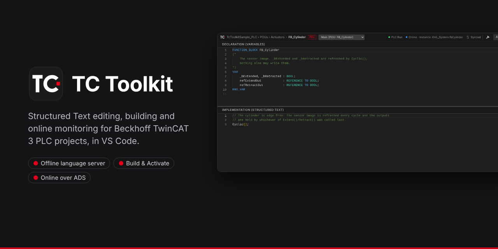
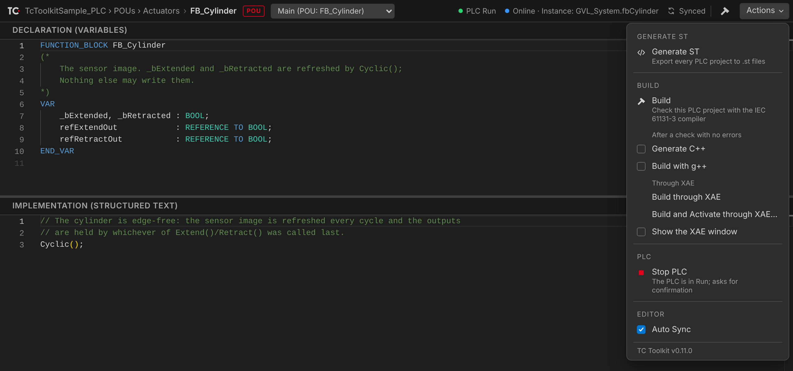
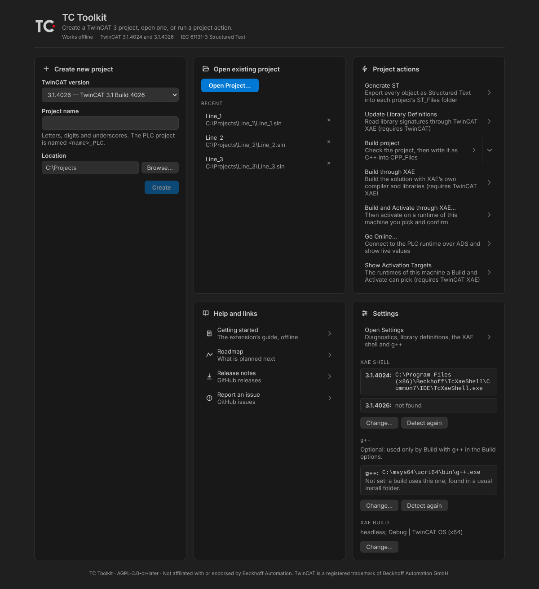

# TC Toolkit

**TC Toolkit** is a VS Code extension for editing, navigating, checking and running **Beckhoff
TwinCAT 3 PLC projects** (`.TcPOU`, `.TcGVL`, `.TcDUT`, `.TcIO`). It hides the XML wrapper behind a
two-pane Structured Text (IEC 61131-3) editor and writes your edits back into the original CDATA, so
TwinCAT and version control see no spurious diffs. A built-in language server, the project and library
explorers and the offline build run without TwinCAT; building and activating through XAE and online
monitoring use the TwinCAT installation on your PC.

> TC Toolkit is not affiliated with or endorsed by Beckhoff Automation. TwinCAT is a registered
> trademark of Beckhoff Automation GmbH.

The **[user guide](docs/user-guide.md)** explains every feature in detail (in VS Code: *Getting
started* in the TC Toolkit sidebar or on the start page). What changed in each release is in the
**[CHANGELOG](CHANGELOG.md)**.

## Install

From version 0.11.1, TC Toolkit is on the
[VS Code Marketplace](https://marketplace.visualstudio.com/items?itemName=a-abushaqra.twincat-plc-toolkit)
and on [Open VSX](https://open-vsx.org/extension/a-abushaqra/twincat-plc-toolkit) (for VSCodium and
other editors that use it):

1. In the **Extensions** view, search for **TC Toolkit** and click **Install** — or run
   `code --install-extension a-abushaqra.twincat-plc-toolkit`.
2. Open the folder with your TwinCAT solution or PLC project and open any `.TcPOU`.

**Without marketplace access** (an offline PC, or a version before 0.11.1): download
`twincat-plc-toolkit-<version>.vsix` from the
[GitHub Releases](https://github.com/AbuShaqra/TC_PLC_Toolkit/releases) and install it with
**Extensions** view → **⋯** → **Install from VSIX…**, or
`code --install-extension twincat-plc-toolkit-<version>.vsix --force`. After replacing an older version
this way, **fully restart VS Code**.

> If a `.TcPOU` opens as raw XML, right-click the tab → **Reopen Editor With… → TC Toolkit**.

**Requirements**

- **VS Code** `^1.66.0` — nothing else for editing, the explorers and the language support.
- **Node.js 22 or newer** for *Build Project* — found by itself (VS Code's own runtime is enough when
  it is Node.js 22+); otherwise install it or set `tcToolkit.compiler.nodePath`.
- **Windows with TwinCAT XAE** (and Windows PowerShell) for *Update Library Definitions* and *Build
  and Activate through XAE*; **TwinCAT XAE or XAR** on this PC for online monitoring (or direct mode
  without TwinCAT).
- Optional: **g++ 7 or later** for *Build with g++*, and Microsoft's **C/C++** extension for
  IntelliSense on the generated C++.

## Features

Each heading links to its section of the user guide.

- **[Two-pane editor](docs/user-guide.md#two-pane-editor)** — Declaration above, Implementation
  below, no raw XML. The header shows where the object lives and its status; **Build** and the
  **Actions ▾** menu (Generate ST, Build options, Start/Stop PLC, Auto Sync) sit on the right.
- **[Sidebar and start page](docs/user-guide.md#tc-toolkit-sidebar-and-start-page)** — the TC Toolkit
  Activity Bar container with **Start**, **PLC Objects** and **PLC Libraries**, and a start page with
  recent projects, project actions and settings. **[Create a new
  project](docs/user-guide.md#create-a-new-twincat-project)** (TwinCAT 3.1.4024 or 3.1.4026) without
  opening XAE.
- **[PLC Objects explorer](docs/user-guide.md#plc-objects-explorer)** — the solution → PLC project →
  object tree; create, delete, drag & drop, copy/paste, insert at cursor, and reference-aware rename
  (including visualizations, text lists and tasks), with the `.plcproj` kept in sync.
- **[PLC Libraries explorer](docs/user-guide.md#plc-libraries-explorer)** — every referenced library
  by its ST namespace, its types, members and methods, with *Insert Definition at Cursor*.
  **[Update Library Definitions](docs/user-guide.md#update-library-definitions)** exports library
  signatures from XAE once.
- **[Structured Text language support](docs/user-guide.md#structured-text-language-support)** —
  context-aware completion, conservative diagnostics, Go to Definition, Find References (the **PLC
  References** panel), pragma support and hover, structural folding.
- **[Generate ST](docs/user-guide.md#generate-st)** — export each PLC project to plain `.st` files
  under `ST_Files/`.
- **[Build Project](docs/user-guide.md#build-project)** — checks a PLC project offline with the
  bundled IEC 61131-3 compiler; problems appear in the Problems panel and the panes. Optionally writes
  the project as **[C++](docs/user-guide.md#c-output-optional)** and compiles it with g++.
- **[Build and Activate through XAE](docs/user-guide.md#build-and-activate-through-xae)** (Windows +
  TwinCAT XAE) — builds with XAE's own compiler, headless by default, and activates on a runtime of
  this PC you pick and confirm; the PLC program is installed as an autostart boot project.
- **[Online monitoring](docs/user-guide.md#online-monitoring-live-values-write-plc-watch)** — live
  values next to the code over ADS, the **PLC Watch** view, confirmed one-off writes (off by default)
  and **Start / Stop PLC**.
- **[TwinCAT 3.1.4026 user-mode runtime](docs/user-guide.md#twincat-314026-user-mode-runtime)** —
  when its router refuses the connection, Go Online switches to TwinCAT's own ADS DLL by itself, and
  *Local runtime* finds the runtime's AMS Net ID.
- **[For AI coding assistants](docs/user-guide.md#for-ai-coding-assistants)** — a portable
  `CLAUDE.md` field guide to the TwinCAT file formats and a headless build harness, in `templates/`.

## Settings

All settings are under `tcToolkit.*` (open them with *Settings* in the sidebar or on the start page).
Values set under the old `twincat.*` names (versions up to 0.10.1) are moved over automatically.

| Group | Settings |
|-------|----------|
| Diagnostics | `tcToolkit.diagnostics.*` — turn each type check on or off |
| Build Project | `tcToolkit.compiler.*` — C++ output, g++ build and path, Node.js path, another compiler build |
| XAE | `tcToolkit.xaeShell.*`, `tcToolkit.xaeBuild.*`, `tcToolkit.libraryDefinitions.shell` |
| Online monitoring | `tcToolkit.online.*`, `tcToolkit.adsDll.*` |
| Start page | `tcToolkit.startPage.recentProjectsShown` |

Every setting, its default and what it does: [user guide, Settings](docs/user-guide.md#settings).

## Known limitations

The full list is in the [user guide](docs/user-guide.md#known-limitations).

- Diagnostics are **conservative, not a compiler**: anything that cannot be fully resolved (including
  most things reached through a library type) is left unflagged. *Build Project* is the full check.
- Library ACTIONs are not completable, and member completion stops after one hop (`axis.Status.▮`).
- A library type is known once the project uses it, or after *Update Library Definitions*;
  `.compiled-library-v3` archives cannot be read ([details](docs/user-guide.md#how-library-symbols-are-resolved)).
- The inline references peek shows only the active component's panes; the **PLC References** panel
  shows everything.
- Through XAE: no remote targets, no single PLC project of a multi-project solution, no route writing.
  Online monitoring cannot force, and cannot see a code-only change that was built but not downloaded.

## Roadmap

What is planned next, in what order and when:
**[TC Toolkit Roadmap](https://claude.ai/artifact/8RG7TZtBV2cuupsrwWtknv)**.

## License

Copyright © 2026 A. AbuShaqra.

From version 0.11.0, this extension's original code is licensed under the
**[GNU Affero General Public License v3.0 or later](LICENSE)** (`AGPL-3.0-or-later`):
you may use, study, change and share it, and anyone who distributes a modified
version, or offers one to users over a network, must make its full source available
under the same licence. Versions up to and including 0.10.1 were released under the
MIT licence, and copies of those versions keep it.

Bundled third-party components (the Monaco Editor, the codicon font, the
TypeScript language services, the bundled compiler, and the runtime npm dependencies)
remain under their own licenses. Monaco's MIT license is at
[`media/monaco-editor/LICENSE.txt`](media/monaco-editor/LICENSE.txt); the full
inventory is in [THIRD-PARTY-NOTICES.md](THIRD-PARTY-NOTICES.md).

## Disclaimer

This is an independent, community-built project. It is **not affiliated with,
endorsed by, or sponsored by Beckhoff Automation GmbH & Co. KG.** TwinCAT is a
registered trademark of Beckhoff Automation GmbH, and "Beckhoff" is a trademark of
Beckhoff Automation; both are used here only to describe compatibility. That is why
the extension is called **TC Toolkit** and its views **PLC Objects**, **PLC
Libraries** and **PLC References** rather than carrying the TwinCAT name. All other
trademarks are the property of their respective owners.
